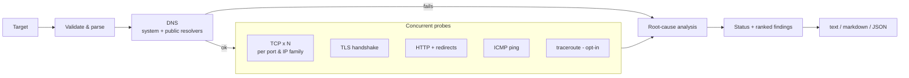

<div align="center">

# NetDoctor

**Find out *why* a website is slow or unreachable, not just *that* it is.**

DNS · TCP · TLS · HTTP · ICMP · path: checked together, then reduced to a root-cause diagnosis you can act on.

[](https://github.com/Ajitesh1234/netdoctor/actions/workflows/ci.yml)


[](LICENSE)

</div>

---

## Why NetDoctor?

`ping` tells you a host answers. `curl` tells you a request failed. Neither tells you *which layer broke* or *whose fault it is*. NetDoctor runs the whole stack of checks concurrently and then reasons about them:

- A **TCP timeout** explains the HTTP timeout, so you get one root cause instead of five symptoms.
- An **expired certificate** explains the failed HTTPS request, so it is not reported twice.
- A **resolver that says "no such domain" while 1.1.1.1 and 8.8.8.8 disagree** is flagged as likely DNS blocking, which is different from a mistyped domain.

It is honest about uncertainty. Anything with an innocent explanation (CDN geo-DNS, bot protection, ICMP filtering) is worded as a possibility, never as a verdict. See [Limitations](#limitations).

## Features

| Layer | What is checked | What it can tell you |
| --- | --- | --- |
| **DNS** | System resolver (IPv4 + IPv6) **plus** an independent raw-UDP query to public resolvers | Domain doesn't exist vs. blocked by your resolver vs. resolver down; sinkhole answers (`0.0.0.0`, `127.x`); slow DNS |
| **TCP** | N handshakes per port **per IP family** → min/avg/max, jitter, loss | Server down, port filtered vs. refused, packet loss, high latency/jitter, **broken IPv6** |
| **TLS** | Full verification, SNI, TLS ≥ 1.2, cert expiry | Expired / self-signed / wrong-host / untrusted-CA certs, expiring soon, **handshake resets (possible SNI filtering)** |
| **HTTP(S)** | Per-hop timing, manual redirect following, HTTPS→HTTP fallback detection | 403 / 429 / 451 / 5xx meaning, redirect loops, slow time-to-first-byte, HTTPS missing |
| **ICMP** | System `ping`, parsed on Linux, macOS, BSD and Windows | Loss and RTT as a cross-check; "ping blocked but site fine" is correctly treated as harmless |
| **Path** | Optional `traceroute` / `tracert` | Where along the route things stop |

**Engineering properties**

- **Zero runtime dependencies**: standard library only. Nothing to audit, nothing to break.
- **Fast**: targets *and* checks run concurrently; every operation has a hard timeout (including DNS, which the stdlib can't time out natively).
- **Fault-isolated**: a bug or failure in one check can never take down the report.
- **Safe by construction**: targets are strictly validated before any traffic is sent; external binaries are invoked with argv lists and validated IP literals only (no shell, no option injection).
- **Machine-friendly**: versioned JSON schema, stable `error_kind` / finding codes, and CI-friendly exit codes.
- **Strictly typed** (`mypy --strict`), `py.typed` shipped, ~95% test coverage.

## Installation

Requires **Python 3.9+**. Works on Linux, macOS and Windows.

```bash
# Recommended: isolated install of the CLI
pipx install git+https://github.com/Ajitesh1234/netdoctor.git

# or into a virtualenv
pip install git+https://github.com/Ajitesh1234/netdoctor.git

# or from a clone (editable, for development)
git clone https://github.com/Ajitesh1234/netdoctor.git
cd netdoctor
pip install -e ".[dev]"
```

**Docker** (the image includes `ping` and `traceroute`):

```bash
docker build -t netdoctor .
docker run --rm netdoctor example.com
```

## Quick start

```bash
netdoctor example.com                      # host, host:port or full URL
netdoctor https://example.com/login        # check a specific URL
netdoctor example.com github.com           # several targets, in parallel
netdoctor example.com --traceroute         # also trace the network path
netdoctor example.com -f markdown -o report.md
netdoctor example.com --json | jq '.reports[0].findings'
python -m netdoctor example.com            # equivalent to the console script
```

If no scheme is given, NetDoctor tries **HTTPS first** and reports whether it had to fall back to plain HTTP.

### Example: your resolver is blocking a site

```text
NetDoctor 1.0.0  -  2026-10-22T09:30:00Z

blocked-site.example  ✖ FAILING  (0.1s)
  Your system resolver says 'blocked-site.example' does not exist, but public resolvers (1.1.1.1, 8.8.8.8) return addresses for it.

  ✖ DNS         nxdomain: gaierror: [Errno -2] Name or service not known

  Findings:
    ✖ Your system resolver says 'blocked-site.example' does not exist, but public resolvers (1.1.1.1, 8.8.8.8) return addresses for it.
        -> Likely DNS-level blocking or a faulty local/ISP resolver. Try switching your DNS server (e.g. 1.1.1.1 or 8.8.8.8) or using DNS-over-HTTPS.
```

### Example: a "slow site" decomposed

```text
NetDoctor 1.0.0  -  2026-10-22T09:30:00Z

https://shop.example  ⚠ DEGRADED  (7.4s)
  IPv6 (2606:4700::6812:202f) is unreachable on port 443, but the other IP family works.

  ✔ DNS         104.18.32.47, 2606:4700::6812:202f (42 ms); 2/2 public resolvers answered
  ⚠ TCP 443/v4  104.18.32.47 avg 61.7 ms, jitter 27.9 ms, loss 20% (4/5)
  ✖ TCP 443/v6  2606:4700::6812:202f timeout: timed out
  ✔ TLS         TLSv1.3, R11, expires in 6 days (handshake 131 ms)
  ✔ HTTP        200 OK via https, TTFB 2310 ms, total 2395 ms, 1 request(s)
  ⚠ ICMP        avg 58.9 ms, jitter 8.4 ms, loss 20%

  Findings:
    ⚠ IPv6 (2606:4700::6812:202f) is unreachable on port 443, but the other IP family works.
        -> Browsers may stall before falling back. Fix or disable the broken IP family.
    ⚠ 20% of connection attempts to 104.18.32.47:443 failed (4/5 succeeded).
        -> Intermittent loss causes retries and stalls. Check Wi-Fi/ISP quality.
    ⚠ The certificate expires in 6 day(s) (2026-10-28T12:00:00Z).
        -> The site owner must renew it before browsers start rejecting the site.
    ⚠ The server took 2310 ms to start responding.
        -> A slow server (not your network) is the likely cause if TCP latency is low.
    ⚠ Ping shows 20% packet loss.
        -> Genuine path loss is likely; check your link and ISP.
```

Both examples above are rendered by NetDoctor's own report engine from representative check data.

## CLI reference

```text
netdoctor [TARGET ...] [options]
```

| Option | Default | Description |
| --- | --- | --- |
| `TARGET` | n/a | One or more of `host`, `host:port`, `http(s)://host[:port]/path`. IPv4/IPv6 literals work. |
| `--sites TARGET ...` | n/a | Alias for positional targets (backward compatible). |
| `-f, --format {text,markdown,json}` | `text` | Output format. `--json` is a shortcut for `-f json`. |
| `-o, --out FILE` | stdout | Write the report to `FILE` (UTF-8). |
| `--timeout SECONDS` | `5.0` | Timeout for every individual network operation. |
| `--samples N` | `5` | TCP connect / ICMP samples per endpoint (1–50). More samples → better jitter and loss estimates. |
| `--workers N` | `4` | Targets diagnosed in parallel (1–32). |
| `--no-icmp` | off | Skip the ping check (e.g. in containers without `ping`). |
| `--no-dns-compare` | off | Don't query public resolvers. Use on air-gapped or privacy-sensitive networks. |
| `--resolver IP` | `1.1.1.1`, `8.8.8.8` | Public resolver for the DNS cross-check; repeatable. |
| `--traceroute` | off | Also run traceroute (can add 20–60 s). |
| `--color {auto,always,never}` | `auto` | ANSI colour; honours `NO_COLOR`. |
| `--ascii` | auto | ASCII symbols instead of Unicode (auto-selected when the terminal can't encode Unicode). |
| `-v, --verbose` | off | Debug logging to stderr (`-vv` for more). |
| `--version` | n/a | Print version. |

### Exit codes

Designed for scripts, cron and CI. With several targets, the **worst** status wins.

| Code | Meaning |
| --- | --- |
| `0` | **Healthy**: no warnings or failures |
| `1` | **Degraded**: reachable but with at least one warning |
| `2` | **Usage error**: bad target or option (no network traffic was sent) |
| `3` | **Failing**: at least one critical problem |
| `130` | Interrupted (Ctrl-C) |

```bash
netdoctor https://api.example.com --no-icmp -f json -o status.json || notify-oncall
```

## How diagnosis works



1. **Parse & validate**: reject anything unsafe before touching the network.
2. **DNS first**: if the name can't be resolved nothing else is attempted, and the public-resolver cross-check decides between *"doesn't exist"*, *"blocked locally"* and *"resolver down"*.
3. **Probe concurrently**: TCP (per port × IP family), TLS, HTTP, ICMP and optionally traceroute run in parallel.
4. **Analyse**: findings are ranked by severity; downstream symptoms of a root cause are suppressed. The overall status is `healthy`, `degraded` or `failing`.

### Finding codes

Every finding has a stable `code` you can match on in automation.

| Severity | Codes |
| --- | --- |
| **critical** | `DNS_NXDOMAIN` `DNS_BLOCKED_LOCALLY` `DNS_UNAVAILABLE` `DNS_FAILED` `TCP_UNREACHABLE` `TCP_HEAVY_LOSS` `TLS_CERT_EXPIRED` `TLS_CERT_NOT_YET_VALID` `TLS_HOSTNAME_MISMATCH` `TLS_SELF_SIGNED` `TLS_CERT_INVALID` `HTTP_SERVER_ERROR` `HTTP_LEGAL_BLOCK` |
| **warning** | `DNS_SINKHOLE` `DNS_SLOW` `TCP_PACKET_LOSS` `TCP_443_UNREACHABLE` `IP_FAMILY_BROKEN` `HIGH_LATENCY` `HIGH_JITTER` `TLS_EXPIRING_SOON` `TLS_UNTRUSTED_ISSUER` `TLS_INTERFERENCE` `TLS_HANDSHAKE_FAILED` `HTTPS_UNAVAILABLE` `HTTP_FORBIDDEN` `HTTP_NOT_FOUND` `HTTP_RATE_LIMITED` `HTTP_CLIENT_ERROR` `HTTP_FAILED` `SLOW_RESPONSE` `ICMP_PACKET_LOSS` |
| **info** | `DNS_MISMATCH` `DNS_PRIVATE` `TCP_PORT_CLOSED` `HTTP_AUTH_REQUIRED` `HTTP_REDIRECTED` `HTTP_REDIRECT_UNFOLLOWED` `ICMP_BLOCKED` |
| **ok** | `ALL_CLEAR` |

Default thresholds (all in [`Config`](src/netdoctor/config.py)): latency > 250 ms, jitter > 30 ms, time-to-first-byte > 1.5 s, DNS > 500 ms, certificate expiry ≤ 14 days.

## JSON output

`--json` emits a stable, versioned document (`schema_version`). Trimmed example:

```json
{
  "tool_version": "1.0.0",
  "generated_at": "2026-10-22T09:30:00Z",
  "reports": [
    {
      "target": "blocked-site.example",
      "host": "blocked-site.example",
      "dns": {
        "ok": false,
        "addresses": [],
        "latency_ms": 31.0,
        "skipped": false,
        "error": "gaierror: [Errno -2] Name or service not known",
        "error_kind": "nxdomain",
        "public": [
          {
            "server": "1.1.1.1",
            "ok": true,
            "addresses": [
              "104.18.32.47"
            ],
            "rcode": 0,
            "latency_ms": 18.0,
            "error": null,
            "error_kind": null
          }
        ]
      },
      "tcp": [],
      "tls": null,
      "http": null,
      "icmp": null,
      "traceroute": null,
      "findings": [
        {
          "severity": "critical",
          "code": "DNS_BLOCKED_LOCALLY",
          "message": "Your system resolver says 'blocked-site.example' does not exist, but public resolvers (1.1.1.1, 8.8.8.8) return addresses for it.",
          "hint": "Likely DNS-level blocking or a faulty local/ISP resolver. Try switching your DNS server (e.g. 1.1.1.1 or 8.8.8.8) or using DNS-over-HTTPS."
        }
      ],
      "status": "failing",
      "summary": "Your system resolver says 'blocked-site.example' does not exist, but public resolvers (1.1.1.1, 8.8.8.8) return addresses for it.",
      "duration_ms": 95
    }
  ],
  "schema_version": 1
}
```

Notes for integrators:

- `error_kind` values are stable identifiers: `timeout`, `refused`, `reset`, `unreachable`, `nxdomain`, `temporary`, `cert_expired`, `hostname_mismatch`, `self_signed`, `untrusted_issuer`, `tls_error`, `redirect_loop`, …
- Fields that don't apply (e.g. `tls` for an `http://` target) are `null`.
- Breaking changes to the schema bump `schema_version` and are listed in the [CHANGELOG](CHANGELOG.md).

## Use as a library

```python
from netdoctor import Config, diagnose, run

report = diagnose("https://example.com", Config(timeout=3, samples=3, icmp=False))
print(report.status.value, "-", report.summary)
for f in report.findings:
    print(f.severity.name, f.code, f.message)

# several targets, concurrently, input order preserved
session = run(["example.com", "github.com"], Config(workers=8))
print(session.worst_status)
```

`diagnose` / `run` never raise on network failures; failures are data in the returned report. They raise `netdoctor.target.TargetError` only for invalid input, before any traffic is sent.

## Security & privacy

- **No telemetry.** NetDoctor talks only to the targets you name and, unless `--no-dns-compare` is set, to the public resolvers listed above (default `1.1.1.1` and `8.8.8.8`), which will see the *hostnames* you check.
- HTTP requests send a `GET` with a `netdoctor/<version>` User-Agent; response bodies are never downloaded.
- Redirects are followed only to `http`/`https` and capped (default 5).
- Run it from **your** machine to diagnose **your** network. Don't expose it as a service that accepts arbitrary targets without adding your own egress controls (it would be an SSRF primitive, like any URL-fetching tool).
- Report vulnerabilities privately: see [SECURITY.md](SECURITY.md).

## Limitations

NetDoctor produces *evidence-based hints*, not proof.

- **DNS comparison** uses IPv4 `A` records. Differing answers are common with CDNs and are only `info` unless the site is also failing.
- **403 and bot protection**: a probe is not a browser. A `403` is reported as *possibly* geo-blocking or bot protection.
- **Latency is measured as TCP handshake time**, which needs no privileges and passes firewalls that drop ICMP. ICMP is a secondary cross-check.
- **Windows ping output** is parsed for English locales only; jitter isn't reported there. Other locales degrade gracefully ("could not parse ping output").
- **Traceroute** support depends on the OS binary being installed and permitted.
- A single run is a single sample in time; for intermittent problems use `--samples 20` or run it repeatedly.

## Development

```bash
git clone https://github.com/Ajitesh1234/netdoctor.git && cd netdoctor
python -m venv .venv && source .venv/bin/activate     # Windows: .venv\Scripts\activate
pip install -e ".[dev]"
pre-commit install            # optional: lint/format on commit

make check                    # lint + format check + mypy --strict + tests with coverage
make test                     # tests only
make fmt                      # auto-format
```

The test suite needs **no internet**. It spins up local HTTP, TLS (with a generated certificate) and UDP-DNS servers, and mocks `ping`/`traceroute`.

### Project layout

```text
src/netdoctor/
├── cli.py            argument parsing, exit codes
├── runner.py         concurrency & fault isolation
├── analysis.py       root-cause diagnosis (the "brain")
├── report.py         text / Markdown / JSON renderers (pure functions)
├── models.py         typed result dataclasses + JSON conversion
├── target.py         strict target parsing/validation
├── config.py         tunables & thresholds
└── checks/           dns · tcp · tls · http · icmp · traceroute (+ util)
tests/                unit + local-server integration tests
```

See [CONTRIBUTING.md](CONTRIBUTING.md) for how to add a check or finding.

## Roadmap

- AAAA comparison and DNS-over-HTTPS cross-check
- Optional continuous mode (`--watch`) with change detection
- Prometheus / OpenMetrics exporter
- Localised Windows `ping` parsing

## License

[MIT](LICENSE) © 2025 Ajitesh Mohapatra
