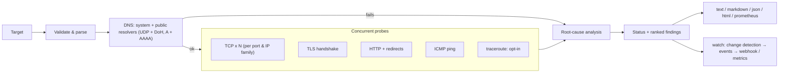

<div align="center">

# NetDoctor

**Find out *why* a website is slow or unreachable, not just *that* it is.**

DNS · DNS-over-HTTPS · TCP · TLS · HTTP · ICMP · path: measured together, reduced to a root-cause diagnosis, and
monitored over time, with Prometheus metrics, signed webhooks and an audit-friendly design.

[](https://github.com/Ajitesh1234/Netdoctor/actions/workflows/ci.yml)
[](https://github.com/Ajitesh1234/Netdoctor/actions/workflows/codeql.yml)


[](LICENSE)

</div>

---

## Why NetDoctor?

`ping` tells you a host answers. `curl` tells you a request failed. Neither tells you *which layer broke* or *whose fault it is*.
NetDoctor runs the whole stack of checks concurrently and then reasons about them:

- A **TCP timeout** explains the HTTP timeout, so you get one root cause instead of five symptoms.
- An **expired certificate** explains the failed HTTPS request, so it is not reported twice.
- A resolver that says "no such domain" while **1.1.1.1 and 8.8.8.8 disagree** is flagged as likely DNS blocking, which is different from a mistyped domain.
- Plain DNS and **encrypted DNS (DoH)** returning different answers is flagged as possible on-path tampering.

It is honest about uncertainty: anything with an innocent explanation (CDN geo-DNS, bot protection, filtered ICMP) is worded as a
possibility, never a verdict. See [Limitations](#limitations).

## Features

| Area | What you get |
| --- | --- |
| **DNS** | System resolver (A **and** AAAA) cross-checked against public resolvers over UDP and, optionally, **DNS-over-HTTPS (RFC 8484)**. Distinguishes *doesn't exist* / *blocked by your resolver* / *resolver down* / *sinkholed* / *possible tampering*. |
| **TCP** | N handshakes per port **per IP family** → min/avg/max, jitter, loss. Finds server-down, filtered vs. refused, packet loss and **broken IPv6**. |
| **TLS** | Full verification, TLS ≥ 1.2, certificate expiry, classified failures, handshake-reset (possible SNI filtering) detection. `--ca-bundle` for corporate CAs. |
| **HTTP(S)** | Per-hop timing, redirect following, HTTPS→HTTP fallback detection, meaningful 403/429/451/5xx diagnosis. |
| **ICMP / path** | Parsed `ping` (Linux, macOS, BSD, Windows) and optional `traceroute`. |
| **Over time** | `--watch`: change detection, recovery timing, **flap damping**, heartbeat, availability summary, graceful shutdown. |
| **Alerting** | **Signed webhooks** (generic JSON or Slack-compatible) with SSRF protection, retries and a non-blocking queue. |
| **Metrics** | **Prometheus** `/metrics` endpoint (loopback by default, optional bearer token) or textfile-collector output. |
| **Reports** | `text`, `markdown`, `json` (versioned schema), **accessible self-contained `html`**, `prometheus`. |
| **Operations** | TOML config file with **strict validation**, `--print-config`, JSON logs, atomic report files, hardened systemd/Docker/Kubernetes examples. |

**Engineering properties**

- **Zero runtime dependencies**: standard library only. Nothing third-party to audit or to be compromised.
- **Fast and bounded**: concurrent checks, a hard timeout on every operation (including DNS), bounded pools and queues, a 500-target cap.
- **Fault-isolated**: a failing check, cycle or notification can never take down the report or the monitor.
- **Safe by construction**: strict input validation, no shell, no way to switch off certificate verification, SSRF-safe webhooks, escaped HTML, redacted secrets. See the [threat model](docs/THREAT_MODEL.md).
- **Supply-chain hygiene**: SHA-pinned CI actions, `bandit` + `pip-audit` + CodeQL gates, signed build-provenance attestations on releases.
- **Verified**: `mypy --strict`, ~97% test coverage (measured on Linux / Python 3.12), a CI matrix of Linux, macOS and Windows × Python 3.9–3.13, and a fuzz-tested DNS parser. The suite needs no internet.

## Installation

Requires **Python 3.9+** (Linux, macOS, Windows).

```bash
pipx install git+https://github.com/Ajitesh1234/Netdoctor.git     # isolated CLI install
pip install "netdoctor-cli[toml]"   # once published to PyPI; the [toml] extra is only needed on Python 3.9/3.10
```

> The PyPI distribution is named **`netdoctor-cli`** (the name `netdoctor` belongs to an unrelated project).
> The command and the Python package are both `netdoctor`.

**Docker** (includes `ping` and `traceroute`; runs as an unprivileged user):

```bash
docker build -t netdoctor . && docker run --rm netdoctor example.com
```

See the [deployment guide](docs/DEPLOYMENT.md) for systemd, Kubernetes, air-gapped installs and release verification.

## Quick start

```bash
netdoctor example.com                          # host, host:port or full URL
netdoctor https://example.com/login github.com # several targets, in parallel
netdoctor example.com --doh                    # add the encrypted-DNS cross-check
netdoctor example.com -f html -o report.html   # shareable, accessible report
netdoctor example.com --json | jq '.reports[0].findings'
netdoctor example.com -w                       # watch: print only what changes
python -m netdoctor example.com                # equivalent to the console script
```

### Example: your resolver is blocking a site

```text
NetDoctor 1.2.0  -  2026-10-22T09:30:00Z

blocked-site.example  ✖ FAILING  (0.1s)
  Your system resolver says 'blocked-site.example' does not exist, but public resolvers (1.1.1.1, 8.8.8.8) return addresses for it.

  ✖ DNS         nxdomain: gaierror: [Errno -2] Name or service not known

  Findings:
    ✖ Your system resolver says 'blocked-site.example' does not exist, but public resolvers (1.1.1.1, 8.8.8.8) return addresses for it.
        -> Likely DNS-level blocking or a faulty local/ISP resolver. Try switching your DNS server (e.g. 1.1.1.1 or 8.8.8.8) or using DNS-over-HTTPS.
```

### Example: a "slow site" decomposed

```text
NetDoctor 1.2.0  -  2026-10-22T09:30:00Z

https://shop.example  ⚠ DEGRADED  (7.4s)
  IPv6 (2606:4700::6812:202f) is unreachable on port 443, but the other IP family works.

  ✔ DNS         104.18.32.47, 2606:4700::6812:202f (42 ms); 2/2 public resolvers answered
  ⚠ TCP 443/v4  104.18.32.47 avg 61.7 ms, jitter 27.9 ms, loss 20% (4/5)
  ✖ TCP 443/v6  2606:4700::6812:202f timeout: timed out
  ✔ TLS         TLSv1.3, R11, expires in 6 days (handshake 131 ms)
  ✔ HTTP        200 OK via https, TTFB 2310 ms, total 2395 ms, 1 request(s)
  ⚠ ICMP        avg 58.9 ms, jitter 8.4 ms, loss 20%

  Findings:
    ⚠ IPv6 (2606:4700::6812:202f) is unreachable on port 443, but the other IP family works.
        -> Browsers may stall before falling back. Fix or disable the broken IP family.
    ⚠ 20% of connection attempts to 104.18.32.47:443 failed (4/5 succeeded).
        -> Intermittent loss causes retries and stalls. Check Wi-Fi/ISP quality.
    ⚠ The certificate expires in 6 day(s) (2026-10-28T12:00:00Z).
        -> The site owner must renew it before browsers start rejecting the site.
    ⚠ The server took 2310 ms to start responding.
        -> A slow server (not your network) is the likely cause if TCP latency is low.
    ⚠ Ping shows 20% packet loss.
        -> Genuine path loss is likely; check your link and ISP.
```

### Example: plain DNS disagrees with encrypted DNS

```text
NetDoctor 1.2.0  -  2026-10-23T09:30:00Z

bank.example  ✖ FAILING  (0.6s)
  The certificate is not valid for 'bank.example'.

  ✔ DNS         185.199.108.153 (18 ms); 2/2 public resolvers answered
  ✔ TCP 443/v4  185.199.108.153 avg 33.2 ms, jitter 1.4 ms, loss 0% (5/5)
  ✖ TLS         hostname_mismatch: certificate is not valid for the requested host
  ✖ HTTP        hostname_mismatch: certificate is not valid for the requested host

  Findings:
    ✖ The certificate is not valid for 'bank.example'.
        -> Misconfigured server, or you are being redirected/intercepted.
    ⚠ Plain DNS answered 185.199.108.153 but encrypted DNS (DoH) answered 104.18.32.47.
        -> Plain port-53 DNS may be tampered with or intercepted on your network. CDNs and geo-aware DNS can cause this too, so confirm from a different network.
```

*(Illustrative sessions rendered by NetDoctor's own report engine from representative check data.)*

## Watch mode: catch the problems that come and go

A single run is a snapshot. Flaky Wi-Fi, an ISP that throttles in the evening, or a certificate about to expire only show up over time.
`--watch` re-runs the full diagnosis on an interval and prints **only what changed**:

```bash
netdoctor https://shop.example --watch                          # every 30 s until Ctrl-C
netdoctor example.com github.com -w --interval 10 --confirm 2   # change reported after 2 consecutive sightings
netdoctor example.com -w --heartbeat 300                        # + a "still alive" line every 5 min
netdoctor example.com -w --json | jq 'select(.event != "heartbeat")'     # JSON Lines
netdoctor example.com -w -o netdoctor.log                       # append events to a file
```

```text
2026-10-23 09:00:00Z  https://shop.example  ✔ HEALTHY   No problems detected.
2026-10-23 09:01:00Z  https://shop.example  ⚠ DEGRADED  was HEALTHY for 1m 00s
    + 40% of connection attempts to 104.18.32.47:443 failed (3/5 succeeded).
        -> Intermittent loss causes retries and stalls. Check Wi-Fi/ISP quality.
2026-10-23 09:01:30Z  https://shop.example  ✖ FAILING   was DEGRADED for 30s
    + Cannot open a TCP connection to shop.example (port 443); the attempt timed out.
        -> Packets are being dropped: the server is down, or a firewall/ISP is filtering.
    - TCP_PACKET_LOSS cleared
2026-10-23 09:06:00Z  https://shop.example  ✔ HEALTHY   recovered after 4m 30s as FAILING
    - TCP_UNREACHABLE cleared

Stopped after 15 run(s) over 6m 00s.
  https://shop.example  HEALTHY for 0s  |  checks 5: healthy 3, degraded 1, failing 1  (60% healthy)
```

- **Silence means nothing changed.** State is the overall status plus the set of warning-or-worse finding *codes*; a latency reading wobbling from 48 ms to 51 ms is not an event.
- **Flap damping (`--confirm N`)**: a change is reported only after N consecutive sightings, so one dropped probe does not page anyone.
- **Events:** `initial`, `change`, `recovered` (with how long the problem lasted), optional `heartbeat`, and `error`. A crashing cycle is reported and monitoring continues.
- **Graceful shutdown:** Ctrl-C (exit 130) and SIGTERM from `docker stop`/systemd/Kubernetes (exit 143) print a per-target availability summary and **flush pending notifications first**.
- **JSON Lines** (`--json`): one object per line with `schema_version`, `event`, `status`, `added`/`removed` findings and the full report, ending with a `summary` line.

### Notifications

```bash
export NETDOCTOR_WEBHOOK_URL='https://hooks.example.com/services/...'   # the URL is a secret
export NETDOCTOR_WEBHOOK_SECRET="$(openssl rand -hex 32)"                # HMAC signing key
netdoctor example.com -w --webhook env:NETDOCTOR_WEBHOOK_URL --confirm 2            # signed JSON
netdoctor example.com -w --webhook env:NETDOCTOR_WEBHOOK_URL --webhook-format slack  # Slack / Mattermost
```

Webhooks are **SSRF-safe by default** (the destination must resolve only to public addresses; the validated IP is pinned against DNS
rebinding; redirects are never followed; HTTPS is required), **signed** (`X-NetDoctor-Signature: sha256=HMAC(secret, "<timestamp>." + body)`),
sent **asynchronously with retries**, and can never stall monitoring. A receiver-side verifier is in the [deployment guide](docs/DEPLOYMENT.md#webhooks).

### Prometheus metrics

```bash
netdoctor example.com -w --metrics-port 9877                        # http://127.0.0.1:9877/metrics
netdoctor --config nd.toml -f prometheus --out-mode 644 -o /var/lib/node_exporter/textfile/netdoctor.prom   # cron + textfile collector
```

Metrics follow Prometheus conventions (seconds, ratios) and include per-target status, DNS/TCP/TLS/HTTP/ICMP timings, certificate days-to-expiry,
active findings, and monitor health (`netdoctor_last_success_timestamp_seconds`, notification counters) so you can alert on the monitor itself.
Full list: [docs/METRICS.md](docs/METRICS.md). Alert rules: [`examples/prometheus-alerts.yml`](examples/prometheus-alerts.yml).

## Output formats

| `-f` | Use it for |
| --- | --- |
| `text` (default) | Terminals (colour with `--color`, `NO_COLOR` honoured; ASCII fallback for legacy consoles) |
| `markdown` | Tickets and wikis |
| `json` | Automation: versioned schema, stable `error_kind` and finding codes, `run_id` + `environment` for correlation |
| `html` | A single self-contained, accessible file (semantic tables, text + symbol status, light/dark/print styles, no JavaScript, strict CSP) |
| `prometheus` | Metrics text for the node_exporter textfile collector |

`-o FILE` writes **atomically** (a collector never sees a half-written file) and creates the file **owner-only (`0600`)**, since reports list internal hostnames and findings. Share deliberately with `--out-mode 640`/`644`.

## Configuration

Everything can live in a TOML file (`--config nd.toml`); precedence is **defaults < file < flags**. The file is validated **strictly**:
a typo such as `intervall` is an error with a "did you mean" hint, never a silently ignored setting. Secrets are referenced as `env:NAME`.

```bash
netdoctor --config nd.toml --print-config     # effective settings, secrets redacted
```

Reference: [docs/CONFIGURATION.md](docs/CONFIGURATION.md) · annotated example: [`examples/netdoctor.toml`](examples/netdoctor.toml) ·
all flags: [docs/CLI.md](docs/CLI.md).

### Exit codes

Designed for scripts, cron and CI. With several targets the **worst** status wins.

| Code | Meaning |
| --- | --- |
| `0` | **Healthy**: no warnings or failures |
| `1` | **Degraded**: reachable but with at least one warning |
| `2` | **Usage error**: bad target, flag or config (no network traffic was sent) |
| `3` | **Failing**: at least one critical problem |
| `130` | Interrupted (Ctrl-C) |
| `143` | Terminated (SIGTERM) |

In watch mode, a run that ends via `--max-runs` exits with the code for the **last** run's status.

## How diagnosis works



1. **Parse & validate**: reject anything unsafe before touching the network.
2. **DNS first**: if the name can't be resolved nothing else is attempted; the cross-checks decide between *doesn't exist*, *blocked locally* and *resolver down*.
3. **Probe concurrently** (TCP per port × IP family, TLS, HTTP, ICMP, optional traceroute).
4. **Analyse**: findings are ranked by severity and downstream symptoms of a root cause are suppressed. The status is `healthy`, `degraded` or `failing`.

### Finding codes

Every finding has a stable `code` you can match on in automation (a test keeps this table in sync with the engine).

| Severity | Codes |
| --- | --- |
| **critical** | `DNS_NXDOMAIN` `DNS_BLOCKED_LOCALLY` `DNS_UNAVAILABLE` `DNS_FAILED` `TCP_UNREACHABLE` `TCP_HEAVY_LOSS` `TLS_CERT_EXPIRED` `TLS_CERT_NOT_YET_VALID` `TLS_HOSTNAME_MISMATCH` `TLS_SELF_SIGNED` `TLS_CERT_INVALID` `HTTP_SERVER_ERROR` `HTTP_LEGAL_BLOCK` |
| **warning** | `DNS_SINKHOLE` `DNS_TAMPERING_SUSPECTED` `DNS_SLOW` `TCP_PACKET_LOSS` `TCP_443_UNREACHABLE` `IP_FAMILY_BROKEN` `HIGH_LATENCY` `HIGH_JITTER` `TLS_EXPIRING_SOON` `TLS_UNTRUSTED_ISSUER` `TLS_INTERFERENCE` `TLS_HANDSHAKE_FAILED` `HTTPS_UNAVAILABLE` `HTTP_FORBIDDEN` `HTTP_NOT_FOUND` `HTTP_RATE_LIMITED` `HTTP_CLIENT_ERROR` `HTTP_FAILED` `SLOW_RESPONSE` `ICMP_PACKET_LOSS` |
| **info** | `DNS_MISMATCH` `DNS_PRIVATE` `TCP_PORT_CLOSED` `HTTP_AUTH_REQUIRED` `HTTP_REDIRECTED` `HTTP_REDIRECT_UNFOLLOWED` `ICMP_BLOCKED` |
| **ok** | `ALL_CLEAR` |

Default thresholds (configurable under `[thresholds]`): latency > 250 ms, jitter > 30 ms, time-to-first-byte > 1.5 s, DNS > 500 ms, certificate expiry ≤ 14 days.

## JSON output

`--json` emits a stable, versioned document (`schema_version`). Trimmed example:

```json
{
  "tool_version": "1.2.0",
  "generated_at": "2026-10-22T09:30:00Z",
  "reports": [
    {
      "target": "blocked-site.example",
      "host": "blocked-site.example",
      "dns": {
        "ok": false,
        "addresses": [],
        "latency_ms": 31.0,
        "skipped": false,
        "error": "gaierror: [Errno -2] Name or service not known",
        "error_kind": "nxdomain",
        "public": [
          {
            "server": "1.1.1.1",
            "ok": true,
            "addresses": [
              "104.18.32.47"
            ],
            "rcode": 0,
            "latency_ms": 18.0,
            "error": null,
            "error_kind": null
          }
        ]
      },
      "tcp": [],
      "tls": null,
      "http": null,
      "icmp": null,
      "traceroute": null,
      "findings": [
        {
          "severity": "critical",
          "code": "DNS_BLOCKED_LOCALLY",
          "message": "Your system resolver says 'blocked-site.example' does not exist, but public resolvers (1.1.1.1, 8.8.8.8) return addresses for it.",
          "hint": "Likely DNS-level blocking or a faulty local/ISP resolver. Try switching your DNS server (e.g. 1.1.1.1 or 8.8.8.8) or using DNS-over-HTTPS."
        }
      ],
      "status": "failing",
      "summary": "Your system resolver says 'blocked-site.example' does not exist, but public resolvers (1.1.1.1, 8.8.8.8) return addresses for it.",
      "duration_ms": 95
    }
  ],
  "schema_version": 1,
  "run_id": "9f2c4e0a7b1d4c3e8a5f6b7c8d9e0f12",
  "environment": {
    "python": "3.12.3",
    "platform": "Linux-6.8-x86_64"
  }
}
```

- `error_kind` values are stable identifiers: `timeout`, `refused`, `reset`, `unreachable`, `nxdomain`, `temporary`, `cert_expired`, `hostname_mismatch`, `self_signed`, `untrusted_issuer`, `tls_error`, `redirect_loop`, …
- Fields that don't apply (e.g. `tls` for an `http://` target) are `null`. New fields are additive; breaking changes bump `schema_version` and are listed in the [CHANGELOG](CHANGELOG.md).

## Use as a library

```python
from netdoctor import Config, Watcher, diagnose, run

report = diagnose(
    "https://example.com", Config(timeout=3, samples=3, icmp=False, doh_servers=("https://dns.google/dns-query",))
)
print(report.status.value, "-", report.summary)
for f in report.findings:
    print(f.severity.name, f.code, f.message)

session = run(["example.com", "github.com"], Config(workers=8))  # concurrent, input order preserved
print(session.worst_status, session.run_id)

# continuous monitoring with your own handler (ticketing, chat, metrics, ...)
watcher = Watcher(["example.com"], Config(), interval=30, confirm=2)
watcher.loop(lambda ev: print(ev.event, ev.target, ev.status.value, ev.summary), max_runs=10)
print(watcher.summary())
```

`diagnose` / `run` never raise on network failures (failures are data in the report). They raise `netdoctor.target.TargetError` only for invalid
input, before any traffic is sent.

## Security, privacy and assurance

- **No telemetry.** NetDoctor talks only to the targets you name, to public resolvers (disable with `--no-dns-compare`; this also disables DoH), and to a
  webhook you configure. Bodies are never downloaded; the `User-Agent` is `netdoctor/<version>`.
- **Threat model** with a control-to-test traceability table, known limitations and explicit non-claims: [docs/THREAT_MODEL.md](docs/THREAT_MODEL.md).
- **Verify releases:** SHA-256 sums plus a Sigstore build-provenance attestation (`gh attestation verify`). See [docs/DEPLOYMENT.md](docs/DEPLOYMENT.md).
- **Report vulnerabilities privately:** [SECURITY.md](SECURITY.md).
- **What this is not:** NetDoctor has **not** been independently audited and holds **no** compliance certification (FedRAMP, Common Criteria, FIPS 140, SOC 2,
  ISO 27001 …). It is built so that your reviewers can evaluate it quickly: no runtime dependencies, documented controls backed by tests, and signed releases.
- Run it from **your** machine to diagnose **your** network. Do not expose it as a service that accepts arbitrary targets without egress controls (like any URL-fetching tool it would be an SSRF primitive).

## Limitations

NetDoctor produces *evidence-based hints*, not proof.

- **Differing DNS answers** are common with CDNs and are only `info` unless corroborated (for example by a DoH disagreement or a failing site).
- **403 and bot protection**: a probe is not a browser. A `403` is reported as *possibly* geo-blocking or bot protection.
- **Latency is measured as TCP handshake time** (needs no privileges, passes firewalls that drop ICMP). ICMP is a secondary cross-check.
- **Windows `ping` output** is parsed for English locales only; jitter is not reported there. Other locales degrade gracefully.
- **A network that lies consistently on every channel** (system DNS, UDP, DoH and TCP) cannot be detected from inside it; compare from an independent network.
- A single run is one sample in time; use `--samples 20`, or `--watch` for intermittent problems.
- Full list: [docs/THREAT_MODEL.md](docs/THREAT_MODEL.md#4-known-limitations-and-residual-risk).

## Development

```bash
git clone https://github.com/Ajitesh1234/Netdoctor.git && cd Netdoctor
python -m venv .venv && source .venv/bin/activate        # Windows: .venv\Scripts\activate
pip install -e ".[dev]"
make check          # ruff + format check + mypy --strict + bandit + tests with coverage gate
python scripts/gen_docs.py   # regenerate docs/CLI.md, CONFIGURATION.md, METRICS.md (a test fails if they are stale)
```

The test suite needs **no internet**: it starts local HTTP, TLS (with generated certificates), UDP-DNS, DoH, webhook and metrics servers, and mocks `ping`/`traceroute`.

```text
src/netdoctor/
├── cli.py         argument parsing, wiring, exit codes, signal handling
├── settings.py    defaults < config file < flags; strict validation; secrets
├── runner.py      concurrency & fault isolation
├── analysis.py    root-cause diagnosis (the "brain")
├── watch.py       continuous monitoring: change detection, flap damping, events
├── notify.py      signed, SSRF-safe, non-blocking webhooks
├── metrics.py     Prometheus exposition + hardened /metrics server
├── report.py      text / Markdown / JSON renderers      htmlreport.py  accessible HTML
├── models.py      typed result dataclasses              target.py      strict target parsing
├── config.py      check tunables & thresholds           fsutil.py / logsetup.py
└── checks/        dns · tcp · tls · http · icmp · traceroute (+ util)
docs/              threat model, deployment, generated CLI / config / metrics references
examples/          annotated config, systemd unit, Kubernetes manifest, Prometheus alerts
```

See [CONTRIBUTING.md](CONTRIBUTING.md) for how to add a check or a finding.

## Roadmap

- Independent security review / penetration test (community help welcome)
- Reproducible-build verification and an SBOM attached to releases
- Localised Windows `ping` parsing; QUIC/HTTP-3 probing
- Optional OpenMetrics exemplars and a ready-made Grafana dashboard

## License

[MIT](LICENSE) © 2025 Ajitesh Mohapatra
